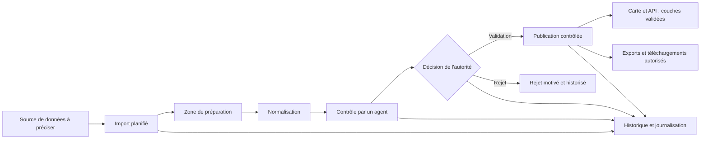
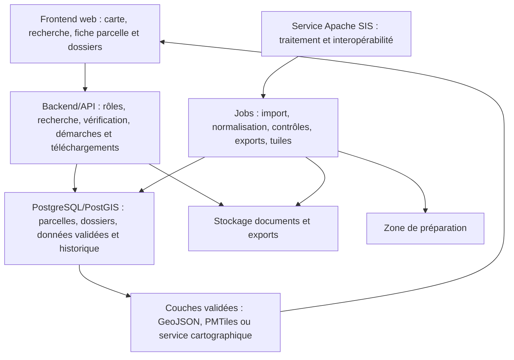

# Dump de référence — Système d'information cadastral centré sur la parcelle

> **Statut :** documentation de cadrage et de transmission.  
> **Langue :** français ; les noms techniques standards sont conservés lorsqu'ils améliorent la précision.  
> **Nature :** ce fichier décrit le projet tel qu'il est actuellement compris à partir des livrables disponibles. Ce n'est ni un registre foncier, ni une spécification juridique, ni la preuve qu'un logiciel de production est déjà déployé.

## 1. Objet du document

Ce dump consolide les éléments métier, techniques et documentaires du projet de mémoire. Il est conçu pour servir à la fois :

- à une personne qui souhaite comprendre rapidement le sujet, son périmètre et les livrables ;
- à une IA ou à un développeur qui doit reprendre la conception sans confondre les hypothèses, les inspirations techniques et les fonctionnalités réellement retenues ;
- à la rédaction du mémoire, notamment pour maintenir la cohérence entre les chapitres, les diagrammes UML, les maquettes et l'architecture.

Le projet vise la **vérification contrôlée d'informations cadastrales sur une parcelle** et la gestion encadrée de dossiers de parcelles. Il aide à consulter une information disponible et validée, à préparer certaines démarches administratives liées à une parcelle et à suivre l'évolution d'informations de statut ; il **ne réalise pas** l'opération foncière elle-même et ne rend aucune décision juridique.

## 2. Lecture rapide

| Question | Réponse courte |
| --- | --- |
| Objet métier principal | La **Parcelle**. |
| Besoin principal | Vérifier des informations cadastrales fiables et gérer des dossiers et démarches encadrées liés aux parcelles. |
| Données sources envisagées | À préciser ultérieurement ; les données seront intégrées via un processus planifié et contrôlé. |
| Données publiées | Uniquement les données passées par le contrôle et la validation. |
| Base principale | PostgreSQL avec extension PostGIS. |
| Utilisateurs | Administrateur, agent de contrôle, autorité de validation, gestionnaire de dossiers et utilisateur autorisé. |
| Carte | Carte interactive affichant uniquement les couches validées. |
| Références françaises data.gouv.fr | Inspirations techniques, **jamais** sources de données sénégalaises. |
| Périmètre exclu | Vente, achat, attribution ou transfert de terrain ; décision juridique ou foncière. |

## 3. Problème traité et limites du système

### 3.1 Problème

Les informations cadastrales peuvent être dispersées, non homogènes ou insuffisamment vérifiées. Il peut alors être difficile de confirmer l'identité cadastrale, la localisation, la superficie, le statut ou une référence administrative disponible pour une parcelle. Une consultation cartographique est utile seulement si les données qu'elle affiche sont fiables, traçables et limitées au niveau d'information autorisé.

Le projet répond à cette difficulté en définissant une chaîne explicite : importer des données, les préparer, les normaliser, les contrôler, les faire valider ou rejeter, puis publier les seules couches validées.

### 3.2 Ce que le système fait

- Centraliser des données cadastrales et géographiques relatives aux parcelles.
- Conserver les attributs essentiels de la parcelle : identité cadastrale, géométrie, superficie, localisation, statut et références administratives disponibles.
- Contrôler la qualité des données avant leur publication.
- Permettre à une autorité compétente de valider ou de rejeter les données contrôlées.
- Rechercher, visualiser et vérifier une parcelle selon les droits de l'utilisateur.
- Fournir des téléchargements de données validées, filtrés par rôle, format et périmètre.
- Journaliser les opérations significatives liées aux imports, contrôles, validations et publications.
- Gérer les dossiers de parcelles, y compris les informations autorisées sur les propriétaires, les statuts et les pièces éventuelles.
- Permettre le dépôt, le suivi et le traitement encadré de certaines démarches administratives : demande d'extrait de plan cadastral et demande de réattribution.
- Présenter l'évolution du statut juridique disponible d'une parcelle, sans interpréter ce statut ni rendre de décision juridique.

### 3.3 Ce que le système ne fait pas

- Il ne vend, n'achète, n'attribue et ne transfère pas de terrain.
- Il ne décide pas des droits de propriété et ne remplace pas les autorités, les procédures juridiques ou les registres officiels.
- Il ne transforme pas une référence de titre foncier disponible en preuve juridique ou en décision foncière.
- Il ne publie pas automatiquement les données brutes importées.

Les démarches administratives prises en charge sont limitées à celles expressément prévues par le projet. Leur suivi ne vaut ni validation foncière, ni attribution, ni décision juridique.

## 4. Cadre métier

### 4.1 Parcelle : objet métier central

La parcelle est l'unité de travail du système. Elle représente une portion de territoire identifiable et localisable. La fiche d'une parcelle peut contenir :

| Groupe d'information | Contenu attendu |
| --- | --- |
| Identification | Identifiant interne, référence cadastrale, section, numéro ou code disponible. |
| Localisation | Commune, zone, rattachements administratifs disponibles et position sur la carte. |
| Géométrie | Polygone ou multipolygone stocké dans PostGIS. |
| Surface | Superficie déclarée, superficie calculée à partir de la géométrie et éventuel écart à contrôler. |
| Statut | État cadastral ou état de publication défini par le projet. |
| Provenance | Source, date d'import, millésime ou date d'effet lorsque l'information existe. |
| Références administratives | Référence de titre foncier ou autre référence disponible, visible selon les droits. |
| Traçabilité | Import d'origine, contrôles, validation, historique des changements et documents éventuels. |

### 4.2 Acteurs et responsabilités

| Acteur | Responsabilités | Limites d'accès |
| --- | --- | --- |
| Administrateur | Gérer les comptes, les rôles, les paramètres et les journaux. | Ne valide pas automatiquement une donnée par son seul rôle d'administration. |
| Agent de contrôle | Examiner les imports, détecter les anomalies, réaliser ou compléter les contrôles. | Ne publie pas une donnée sans décision de validation. |
| Autorité de validation | Valider ou rejeter une donnée ou un import contrôlé et autoriser la publication. | Sa décision est journalisée ; elle ne constitue pas une décision juridique sur la propriété. |
| Utilisateur autorisé | Rechercher, visualiser, vérifier une parcelle et télécharger ce que son rôle permet. | Ne voit que les champs, documents et périmètres autorisés. |
| Gestionnaire de dossiers | Gérer les dossiers de parcelles, les demandes d'extrait de plan cadastral et de réattribution, ainsi que leur suivi. | Ne rend aucune décision juridique, foncière ou d'attribution. |
| Source de données / service cartographique | Fournir les données d'entrée ou diffuser des couches validées. | N'est pas un acteur de décision métier dans l'application. |

### 4.3 Accès et visibilité

Le principe est le **moindre privilège** : l'utilisateur accède uniquement aux fonctionnalités et aux données nécessaires à son rôle.

- Une vue publique ou très limitée peut exposer une géométrie simplifiée, une référence et un statut public, si cette politique est retenue.
- La vue agent peut inclure les données complètes nécessaires au contrôle.
- La vue de validation peut inclure les résultats de contrôle, les anomalies et l'historique.
- Les documents, références administratives sensibles et exports doivent être filtrés avant toute réponse API ou téléchargement.

## 5. Cycle de vie des données

### 5.1 Flux cible

### 5.2 Étapes et règles

1. **Acquisition planifiée** — Le système récupère ou reçoit un lot depuis une source géographique identifiée. La source définitive reste à préciser ; la source, la date et le périmètre sont enregistrés pour chaque lot.
2. **Zone de préparation** — Les données brutes restent séparées des données publiables. Cette zone sert aux conversions, aux corrections contrôlées et aux diagnostics.
3. **Normalisation** — Les champs, formats, systèmes de coordonnées, codes et valeurs sont harmonisés selon les règles du projet.
4. **Contrôle** — L'agent examine les résultats automatiques et, si nécessaire, les cas particuliers. Exemples : géométrie invalide, référence en double, champs obligatoires manquants, surface incohérente, chevauchement anormal.
5. **Validation ou rejet** — L'autorité compétente prend une décision motivée. Une donnée rejetée ne doit pas rejoindre les couches de publication.
6. **Publication** — Les seules données validées alimentent la carte, la recherche et les exportations autorisées.
7. **Historique** — Les opérations importantes conservent au minimum leur auteur, leur date, leur type, leur objet et, lorsque pertinent, la justification ou les valeurs avant/après.

### 5.3 Contrôles de qualité recommandés

| Contrôle | Objectif |
| --- | --- |
| Unicité de la référence cadastrale | Éviter les doublons de parcelles actives. |
| Validité PostGIS de la géométrie | Vérifier que le polygone ou multipolygone est exploitable. |
| Présence des champs obligatoires | Garantir l'identification minimale de la parcelle. |
| Comparaison des surfaces | Détecter un écart significatif entre surface déclarée et surface calculée. |
| Détection de chevauchements | Identifier les intersections anormales entre parcelles actives. |
| Cohérence source / date / millésime | Rendre les données interprétables dans le temps. |
| Contrôle de documents éventuels | Vérifier le type, le rattachement et les droits d'accès. |

## 6. Architecture technique cible

### 6.1 Principe général

L'architecture est organisée autour de deux services majeurs, avec une séparation entre l'affichage, les règles métier, le traitement asynchrone, les données et la publication cartographique. Aucun choix de framework définitif n'est encore imposé par les chapitres ; les éléments ci-dessous sont donc une **architecture cible**.

1. **Service de traitement des données et d'interopérabilité** — Il met en œuvre le flux import → préparation → normalisation → contrôle → validation/rejet → publication. Il s'appuie sur la bibliothèque Java **Apache SIS** et ses normes afin de traiter les données géographiques, leurs systèmes de référence, leurs métadonnées et leur interopérabilité.
2. **Service de gestion des dossiers de parcelles** — Il gère les dossiers, les informations autorisées relatives aux propriétaires, les statuts, les demandes d'extrait de plan cadastral, les demandes de réattribution et le suivi des démarches. Il ne rend pas de décision juridique ou foncière.

### 6.2 Composants

| Composant | Rôle | Exigences principales |
| --- | --- | --- |
| Frontend cartographique | Afficher la carte, rechercher et sélectionner une parcelle, présenter la fiche selon le rôle. | Interface claire, chargement de couches validées seulement, gestion des erreurs et de la visibilité. |
| Service Apache SIS de traitement et d'interopérabilité | Traiter les données géographiques selon le flux de publication contrôlée. | Apache SIS, gestion des référentiels spatiaux, métadonnées, normalisation et interopérabilité. |
| Service de gestion des dossiers | Gérer les dossiers de parcelles, propriétaires, statuts et démarches autorisées. | Accès par rôle, suivi des demandes, pièces contrôlées et absence de décision juridique ou foncière. |
| Backend/API | Appliquer les règles métier et les droits des deux services. | Recherche filtrée, vérification, journalisation, démarches, réponses limitées par rôle, validation serveur. |
| PostgreSQL/PostGIS | Base principale des parcelles, géométries, dossiers, statuts, validations et historiques. | Contraintes relationnelles, index spatiaux, requêtes et contrôles PostGIS. |
| Zone de préparation | Isoler les données importées avant publication. | Aucune publication directe ; conservation de la provenance et des résultats de contrôle. |
| Jobs asynchrones | Exécuter les opérations longues. | Imports, conversions, calculs de surface, génération de tuiles et exports sans bloquer l'interface. |
| Service cartographique / fichiers dérivés | Diffuser les données validées sur la carte ou au téléchargement. | Formats adaptés au web et exports pré-générés pour les gros volumes. |
| Stockage de fichiers | Conserver documents éventuels, fichiers sources et exports. | Références traçables, accès contrôlé, conservation séparée de la base relationnelle. |

### 6.3 API métier à prévoir

Les endpoints ci-dessous sont des interfaces cibles, non des routes déjà implémentées. Ils devront être versionnés, documentés par OpenAPI/Swagger et protégés par rôle.

| Besoin | Interface indicative | Règle essentielle |
| --- | --- | --- |
| Recherche | `GET /api/v1/parcelles?commune=&statut=&reference=` | Pagination, filtres autorisés, champs masqués selon le rôle. |
| Fiche parcelle | `GET /api/v1/parcelles/{id}` | Réponse adaptée à la visibilité de l'utilisateur. |
| Historique | `GET /api/v1/parcelles/{id}/historique` | Réservé aux rôles autorisés. |
| Import | `POST /api/v1/imports` | Crée un lot en préparation, sans publication immédiate. |
| Suivi d'import | `GET /api/v1/imports/{id}` | Expose statut, anomalies et résultats de contrôle selon le rôle. |
| Décision | `POST /api/v1/imports/{id}/validation` | Enregistre validation ou rejet motivé par l'autorité compétente. |
| Couches | `GET /api/v1/couches/parcelles/...` | Sert uniquement des couches validées. |
| Export | `GET /api/v1/exports/parcelles?zone=&format=` | Contrôle du rôle, du périmètre et du format avant téléchargement. |
| Dossier parcelle | `GET /api/v1/parcelles/{id}/dossier` | Réservé aux rôles autorisés ; les données sensibles sont filtrées. |
| Demande d'extrait | `POST /api/v1/parcelles/{id}/demandes/extrait-plan` | Crée et suit une demande ; ne constitue pas une décision administrative ou juridique. |
| Demande de réattribution | `POST /api/v1/parcelles/{id}/demandes/reattribution` | Enregistre et suit le dossier, sans attribuer ni transférer le terrain. |

L'API ne doit pas exposer directement PostGIS, PostgREST ou les tables de préparation.

## 7. Modèle de données textuel

| Entité | Responsabilité | Relations principales |
| --- | --- | --- |
| `Parcelle` | Représente l'objet cadastral central. | Possède des références administratives, documents éventuels, historiques, provenance d'import et appartenance à des couches. |
| `RéférenceAdministrative` | Conserve une référence administrative disponible, dont une référence de titre foncier si elle existe. | Rattachée à une parcelle ; visibilité limitée par les droits. |
| `Document` | Référence un fichier éventuel lié à une parcelle ou à un import. | Rattaché à la parcelle ou au lot importé ; accès contrôlé. |
| `ImportDonnees` | Représente un lot acquis depuis une source. | Possède une source, un périmètre, un état, des anomalies et une ou plusieurs décisions. |
| `Validation` | Trace une décision de validation ou de rejet. | Rattachée à un import ou à des données concernées ; liée à l'autorité et à une date. |
| `HistoriqueOperation` | Journalise les actions importantes. | Référence l'entité concernée, l'auteur, la date, l'action et une justification éventuelle. |
| `CoucheCartographique` | Décrit une couche publiable sur la carte. | Contient uniquement des données validées et une configuration de diffusion. |
| `Utilisateur` | Représente une personne qui accède au système. | Porte un ou plusieurs rôles et est associé aux actions journalisées. |
| `Rôle` | Définit les permissions. | Attribué à des utilisateurs ; gouverne la visibilité et les actions autorisées. |
| `DossierParcelle` | Regroupe les informations et pièces autorisées liées à une parcelle. | Rattaché à une parcelle ; géré selon les rôles et journalisé. |
| `DemarcheAdministrative` | Représente une demande autorisée, telle qu'un extrait de plan ou une réattribution. | Rattachée à une parcelle et à un dossier ; son suivi ne produit pas une décision juridique ou foncière. |
| `StatutParcelle` | Conserve les états cadastraux ou juridiques disponibles et leur historique. | Rattaché à une parcelle ; présenté à titre informatif, sans interprétation juridique par le système. |

### 7.1 États importants

| Objet | États ou décisions utiles |
| --- | --- |
| Import | reçu, en préparation, normalisé, contrôlé, en attente de validation, validé, rejeté, publié, archivé. |
| Contrôle | conforme, anomalie détectée, à compléter, corrigé, non conforme. |
| Publication | non publiable, autorisée, publiée, retirée. |
| Téléchargement | autorisé ou refusé selon l'utilisateur, le périmètre, le format et la sensibilité des données. |
| Démarche administrative | déposée, en cours, à compléter, clôturée ou archivée ; ces états décrivent le suivi administratif, pas une décision juridique ou foncière. |

## 8. Carte, recherche, vérification et téléchargements

### 8.1 Carte interactive

La carte affiche les couches validées. L'utilisateur peut naviguer, zoomer, chercher une zone ou une référence, puis sélectionner une parcelle. La fiche affichée dépend de son rôle. Les couches lourdes peuvent être publiées sous forme de tuiles ou de fichiers dérivés afin de préserver les performances.

### 8.2 Vérification d'une parcelle

La vérification est la fonctionnalité métier centrale. Elle consiste à présenter les informations disponibles et validées de la parcelle : identité cadastrale, géométrie, superficie, localisation, statut, provenance et références administratives visibles. Elle peut signaler les limites de l'information, par exemple l'absence de référence administrative ou une date de mise à jour ancienne.

Cette fonctionnalité prépare une décision humaine avant une opération foncière ; elle ne réalise pas l'opération et ne détermine pas un droit de propriété.

### 8.3 Téléchargements

Les téléchargements portent sur des jeux de données validés. L'API doit sélectionner le format et le périmètre adéquats, par exemple une commune, une zone ou une couche. Les gros exports devraient être préparés à l'avance lorsqu'ils sont fréquents, plutôt que générés intégralement à chaque demande.

## 9. Inspirations techniques et séparation des sources

### 9.1 Sources de données à définir

La ou les sources de données cadastrales et géographiques seront précisées ultérieurement. Avant leur intégration, le projet devra confirmer les modalités d'accès, les licences, les formats, la fréquence de mise à jour et la qualité des données. Toute donnée reçue suivra le processus de préparation, normalisation, contrôle et validation avant publication.

### 9.2 Références techniques françaises

| Référence | Principe retenu pour le projet |
| --- | --- |
| `udata` | Catalogage, métadonnées, gestion des accès, recherche et séparation entre fiche descriptive et ressource. |
| `hydra` | Contrôles, détection de changements, conversions, traitements asynchrones et historisation technique. |
| `api-tabular` | API intermédiaire avec pagination, filtres autorisés, sélection de colonnes et exports contrôlés. |
| `datagouvfr_data_pipelines` | Pipelines planifiés pour l'import, la consolidation, les contrôles et la génération d'artefacts. |
| `cadastre.data.gouv.fr` | Diffusion par millésime, formats adaptés aux usages géographiques et consultation structurée. |
| `cadastre-bundler-api` | Exports pré-générés ou assemblés par zone, couche et format. |

**Règle non négociable :** data.gouv.fr, ses dépôts et les données cadastrales françaises sont des références d'architecture et de conception. Ils ne sont pas des sources de données sénégalaises pour ce projet.

## 10. État documentaire du mémoire

### 10.1 Livrables utiles

| Élément | Statut et usage |
| --- | --- |
| Chapitre 1 académique | Version reformulée ; présente le contexte, la problématique, les objectifs et la méthodologie du système cadastral centré sur la parcelle. |
| Chapitre 2 académique | Version reformulée ; présente les acteurs, besoins, UML, architecture, données, technologies, interfaces et inspirations techniques. |
| Éléments liminaires avec glossaire | Plan détaillé, sommaire prévisionnel, avant-propos, résumé, abstract, mots-clés et glossaire. |
| Canevas de rédaction | Référence de structure académique : introduction générale, travaux réalisés, conclusion générale. |
| Mémoire principal officiel | Référence de forme et de mise en page ; son contenu historique ne correspond pas entièrement au nouveau périmètre cadastral. |
| Notes data.gouv.fr | Références techniques détaillées pour justifier les choix d'architecture et de traitement des données. |

### 10.2 Structure documentaire cible

1. Pages préliminaires : dédicace, remerciements, avant-propos, sommaire, glossaire, listes, résumé et abstract.
2. Chapitre 1 : introduction générale au problème cadastral, objectifs et méthodologie.
3. Chapitre 2 : analyse, conception, données, UML, architecture, technologies et interfaces attendues.
4. Chapitre 3 : conclusion générale, bilan des objectifs, limites, apports personnels et perspectives.
5. Bibliographie, webographie et annexes.

### 10.3 Écarts documentaires connus

- Le mémoire principal existant contient une ancienne structure et des contenus liés à un autre sujet ; il ne doit pas être utilisé comme vérité métier pour le projet cadastral.
- Les chapitres académiques et les éléments liminaires sont les références rédactionnelles les plus récentes pour le périmètre cadastral.
- Certaines notes techniques plus anciennes peuvent encore citer des démarches administratives non retenues. Dans ce projet, seules les demandes d'extrait de plan cadastral et de réattribution, ainsi que leur suivi, font partie du périmètre ; elles sont distinctes de `ImportDonnees`, `Contrôle` et `Validation`.
- Le chapitre 3 reste à rédiger et devra respecter les limites annoncées dans les chapitres 1 et 2.
- Le sommaire final et les numéros de page devront être actualisés après l'assemblage complet du mémoire dans Word.

## 11. État du projet, limites et prochaines étapes

### 11.1 Éléments confirmés

- La parcelle est l'objet métier central.
- PostgreSQL/PostGIS est la base principale prévue.
- Les données suivent un cycle import → préparation → normalisation → contrôle → validation/rejet → publication.
- La carte et les téléchargements ne doivent servir que des données validées.
- Les rôles limitent les actions et la visibilité des données.
- La source des données reste à préciser ; data.gouv.fr est une inspiration technique uniquement.
- Apache SIS est la bibliothèque Java prévue pour le service de traitement et d'interopérabilité des données géographiques.
- Les transactions foncières et les décisions juridiques sont hors périmètre. Certaines démarches administratives explicitement prévues peuvent être gérées et suivies.

### 11.2 Hypothèses de conception

- Un backend/API sécurisé assurera les permissions, la recherche, la vérification, la gestion des dossiers et démarches, le téléchargement et la journalisation.
- Deux services majeurs structureront le système : le traitement et l'interopérabilité des données avec Apache SIS, et la gestion des dossiers de parcelles.
- Des jobs asynchrones pourront traiter les imports, les contrôles et les exports volumineux.
- GeoServer, PMTiles, GeoJSON ou une solution comparable pourront servir les couches validées selon le niveau d'interopérabilité recherché.
- Les documents éventuels seront référencés et protégés selon les mêmes règles de rôle que les données administratives.

### 11.3 Décisions à prendre avant une implémentation complète

1. Définir les rôles définitifs et la politique précise de visibilité des champs sensibles.
2. Définir les sources de données, leurs modalités d'accès, licences, formats et fréquence de mise à jour.
3. Choisir le stack applicatif du prototype : framework frontend, framework backend, mécanisme de jobs et mode de diffusion cartographique.
4. Définir les états officiels d'une parcelle, d'un import et d'une validation.
5. Définir les seuils d'alerte pour les écarts de surface et les chevauchements.
6. Déterminer les formats d'export autorisés, les périmètres téléchargeables et les règles de conservation des fichiers.

### 11.4 Prochaines étapes documentaires

- Intégrer les chapitres académiques et les éléments liminaires dans le mémoire principal.
- Rédiger le chapitre 3 en distinguant objectifs atteints, limites et perspectives.
- Produire les diagrammes UML et les maquettes mentionnés au chapitre 2.
- Mettre à jour le sommaire, les listes des figures et les listes des tableaux après assemblage.
- Harmoniser la bibliographie et la webographie avec les sources effectivement citées.

## 12. Index des fichiers

| Fichier relatif | Rôle dans le projet |
| --- | --- |
| `chat-outputs/chapitre_1_introduction_generale_cadastre_parcelle_academique.docx` | Référence rédactionnelle principale pour le contexte, le périmètre et les objectifs. |
| `chat-outputs/chapitre_2_travaux_realises_cadastre_parcelle_academique.docx` | Référence rédactionnelle principale pour l'analyse, la conception et l'architecture. |
| `chat-outputs/elements_preliminaires_memoire_cadastral_avec_glossaire.docx` | Plan, sommaire, avant-propos, résumé, abstract et glossaire. |
| `datagouv/datagouv_recherche_systeme_donnees.md` | Analyse synthétique des enseignements data.gouv.fr pour le système cadastral. |
| `datagouv/datagouv_details_techniques_interactions.md` | Détails techniques : composants, interactions, API, stockage, pipelines et contrôles. |
| `../official/memoire_licence_,mine.docx` | Mémoire principal existant ; référence de forme, à réviser pour le contenu cadastral. |
| `../../Project Ressource/memoire_licence.docx` | Exemple de mémoire utilisé comme référence documentaire. |
| `../../Project Ressource/Memoire Awa THIAM.pdf` | Exemple de mémoire utilisé comme référence de présentation et de sections liminaires. |
| `../../documentation/Introduction à UML.pdf` | Ressource de référence pour la modélisation UML. |

## 13. Matrice de traçabilité

| Partie du dump | Sources principales | Statut de l'information |
| --- | --- | --- |
| Problème, périmètre et objectifs | Chapitre 1 académique | Confirmé par les livrables révisés. |
| Acteurs, besoins, UML et maquettes | Chapitre 2 académique | Confirmé pour la conception fonctionnelle. |
| Parcelle, cycle de données et validation | Chapitres 1 et 2 académiques | Confirmé. |
| Architecture, API cible, contrôles et exports | Chapitre 2 + notes data.gouv.fr | Architecture cible ; technologies finales à confirmer. |
| Inspirations data.gouv.fr | Deux notes data.gouv.fr | Références techniques uniquement. |
| Avant-propos, résumé, abstract, glossaire et plan | Éléments liminaires avec glossaire | Livrable rédactionnel prêt à intégrer. |
| Forme générale du mémoire | Canevas, mémoire principal et exemples | Référence de structure ; ancien contenu à ne pas reprendre comme périmètre métier. |

---

## Consignes de reprise par une IA ou un contributeur

1. Toujours traiter la parcelle comme l'objet central du domaine.
2. Toujours distinguer les données brutes importées des données validées et publiables.
3. Toujours mentionner que data.gouv.fr est une inspiration technique et non une source sénégalaise.
4. Ne jamais ajouter de démarche administrative autre que la demande d'extrait de plan cadastral, la demande de réattribution et leur suivi, ni de module de transaction, d'attribution effective ou de décision juridique, sans une décision explicite de changement de périmètre.
5. Lorsqu'une information est incertaine, la présenter comme hypothèse ou décision à prendre, jamais comme fonctionnalité déjà réalisée.
